# Manual de usuario — Dolospi

La página es [https://cameras.dolospi.com](https://cameras.dolospi.com). 

Este manual tiene tres partes:

1. La cámara
2. La página web
3. Cómo vincular la cámara la primera vez

---

## 1. La cámara: carga, interruptor y luz

### 1.1 Cargar

Conecta el cable de carga al puerto de la cámara.

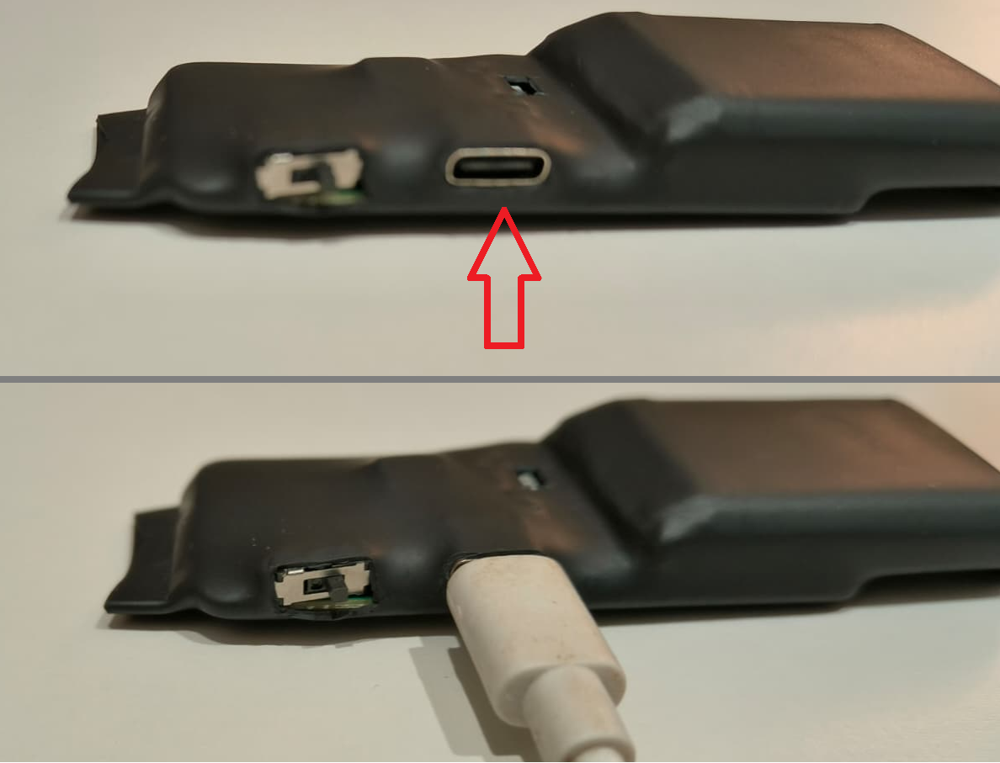

La luz azul indica el nivel de carga aproximado (4 LEDs marcan el nivel de carga de la batería). Al cargar, la luz azul parpadea. Una vez se ha cargado la batería por completo, los 4 LEDs quedan encendidos fijos.

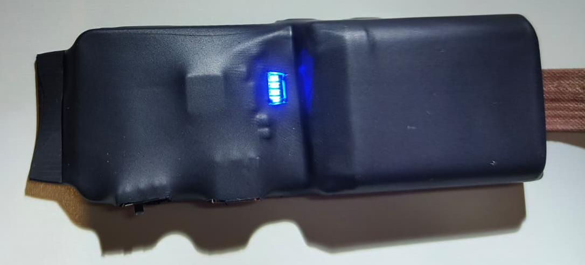
### 1.2 Encender y apagar

La cámara se enciende y se apaga con el interruptor. Al encenderse se activan los LEDs de carga según el nivel de batería de forma fija. Al apagar, los LEDs tardan unos segundos en apagarse, es completamente normal.

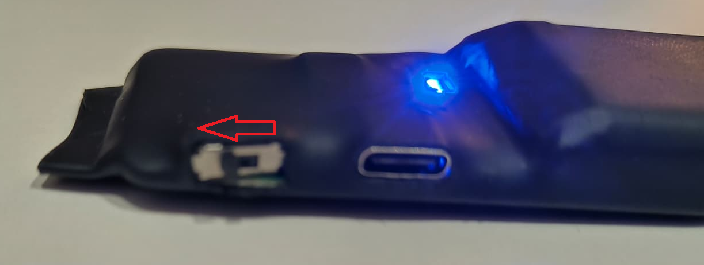

- **Encendida:** arranca, busca una red que ya conozca y, si la encuentra, se conecta a ella.
- **Apagada:** no hace fotos y no recibe datos del servidor. Lo que cambies en la web se guarda (en el servidor), pero se queda esperando hasta que vuelvas a encenderla y tenga internet para sincronizarse.

Espera a que termine de arrancar antes de hacer una foto. Tras encenderla, puede tardar cerca de medio minuto en aparecer **En línea**.

### 1.3 Qué significa la luz verde

La luz verde está en el anverso de la placa.

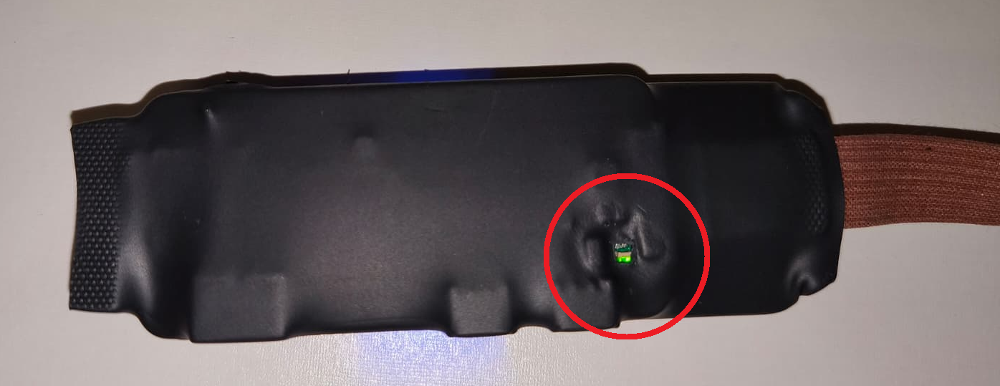

| Lo que hace el LED                        | Qué está pasando                                  |
| --------------------------------- | ------------------------------------------------- |
| Parpadea al encender              | La cámara está arrancando. Es normal y dura poco. |
| Apagada, ya pasados esos segundos | No está conectada a ninguna red Wi‑Fi.                     |
| Fija, encendida                   | Está conectada a una red Wi‑Fi.                            |
| Se apaga un instante y vuelve     | Está haciendo una foto.                           |

La luz fija significa que tiene Wi‑Fi y acceso a la red. No significa, por sí sola, que tengo acceso a Internet ni que ya esté vinculada a tu cuenta. Eso se comprueba en la web, donde debe poner **En línea**.

---

## 2. La página web

### 2.1 Entrar y elegir tu contraseña

La cuenta no se crea en la página, es por invitación: un usuario y una contraseña. La primera vez el acceso será el usuario que elijas, y ese mismo usuario como contraseña.

1. Abre [https://cameras.dolospi.com](https://cameras.dolospi.com).
2. Escribe el usuario y la contraseña.
3. Pulsa **Entrar**.

Al entrar aceptas las condiciones de uso.

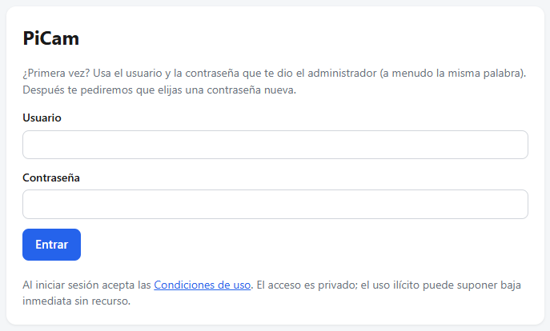

La primera vez la página te pide una contraseña nueva:

- mínimo 8 caracteres
- no puede ser igual que tu usuario
- hay que escribirla dos veces
- pulsa **Guardar contraseña**

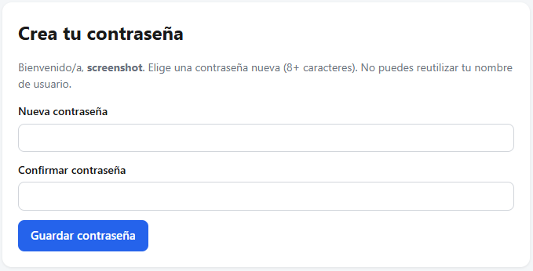

A partir de ahí entras con el usuario y con esa contraseña nueva.

Para cerrar la sesión, en **Mis cámaras** pulsa **Salir**.

### 2.2 Mis cámaras

Al entrar ves **Mis cámaras**. Cada cámara muestra su nombre, si está **En línea** o **Desconectada**, y su identificador.

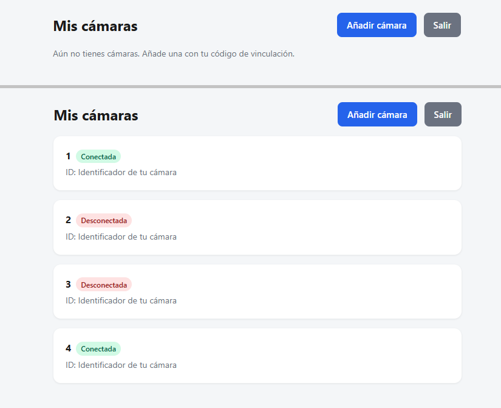

**Añadir cámara** sirve para vincular una cámara nueva. El paso a paso está en la parte 3. Conviene leer bien el apartado del Wi‑Fi, porque la lista de redes se guarda en la cuenta.

Pulsa el nombre de una cámara para abrirla.

### 2.3 Hacer una foto

Arriba ves el nombre y el estado. **En línea** permite hacer fotos. **Desconectada** no: los botones no responden. Comprueba que el interruptor está encendido y que la luz verde está fija.

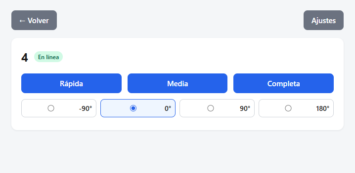

Hay tres botones:

- **Rápida** — la más ligera y rápida, pero menor resolución
- **Media** — punto intermedio
- **Completa** — la más pesada; tarda más pero ofrece la mayor resolución

Estos botones son configurables, ver apartado 2.6
Mientras trabaja, la pantalla pone **Capturando…** y la luz verde se apaga un instante. La foto se queda en la pantalla hasta que haces otra. La página no guarda un álbum: si sales o haces otra foto, la anterior deja de estar ahí. Cópiala o guárdala antes.

Si la cámara está apagada, o encendida pero sin Wi‑Fi, la foto no aparece. La página no la recibe y sale un mensaje de error.

### 2.4 Girar, copiar y guardar

Debajo de la foto puedes girarla: **0°**, **90°**, **-90°** o **180°**. Eso solo cambia cómo se ve en la pantalla.

Al copiar o guardar (mantén pulsada la foto en el móvil, o clic derecho en el ordenador) el archivo es la foto original, sin el giro aplicado. 

### 2.5 Ajustes de esta cámara

Pulsa **Ajustes** y deja abierta la pestaña **Esta cámara**.

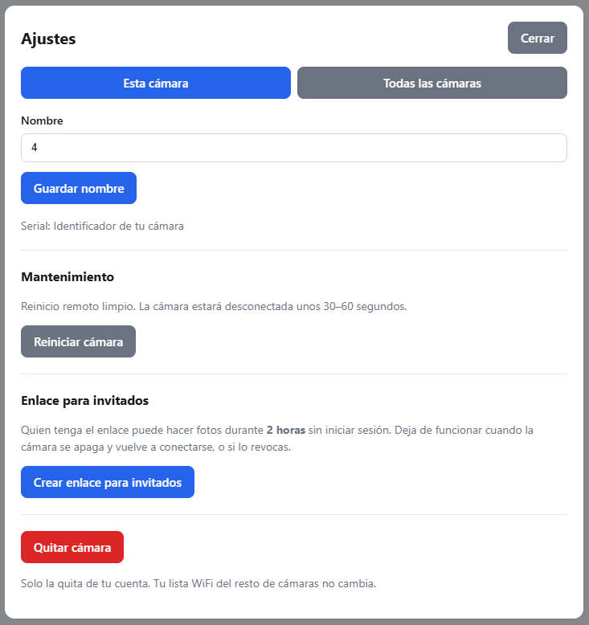

**Nombre.** Escribe el nombre y pulsa **Guardar nombre**. El nombre solo existe en la página. Cambia al momento, aunque la cámara esté apagada. Debajo está el número de serie, por si te lo piden.

**Reiniciar cámara.** La apaga y la vuelve a encender a distancia. Estará **Desconectada** unos 30–60 segundos y luego debería volver **En línea**. El botón solo se puede pulsar si ya está **En línea**. Si está apagada con el interruptor, este botón no la enciende: hay que usar el interruptor.

**Enlace para invitados.** La cámara tiene que estar **En línea** para crear el enlace.

1. Pulsa **Crear enlace para invitados**.
2. Pulsa **Copiar enlace** y envíaselo a la otra persona.

Quien tenga el enlace puede hacer fotos durante **2 horas** sin cuenta y sin contraseña. Ve los mismos botones de foto y puede girar la imagen. No ve ajustes, ni el Wi‑Fi, ni el resto de tus cámaras.

El enlace deja de servir en cualquiera de estos casos:

- pasan las 2 horas
- pulsas **Revocar enlace**
- la cámara se apaga y vuelve a conectarse

**Quitar cámara.** La elimina de tu cuenta. No borra las redes Wi‑Fi del resto de tus cámaras. El código de vinculación de la tarjeta deja de valer: para volver a añadirla hace falta un código nuevo, que te tiene que dar un administrador.

### 2.6 Ajustes de todas las cámaras

En **Ajustes**, abre **Todas las cámaras**. Estas configuraciones se aplican para todas las cámaras de la cuenta, no solo para la que tienes abierta.

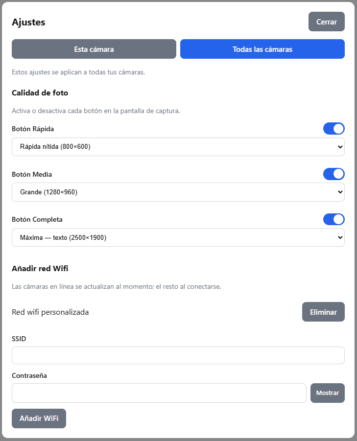

**Calidad de foto.** Cada botón (**Rápida**, **Media**, **Completa**) tiene un interruptor y una lista:

| Botón    | Opciones                                     |
| -------- | -------------------------------------------- |
| Rápida   | Rápida (640×480), Rápida nítida (800×600)    |
| Media    | Estándar (1024×768), Grande (1280×960)       |
| Completa | Alta (1920×1440), Máxima — texto (2500×1900) |

El interruptor muestra u oculta ese botón en la pantalla de la foto. Tiene que quedar al menos uno visible. Estas opciones se guardan en tu cuenta al momento. La cámara no las memoriza: la página se las envía cada vez que pides una foto, así que hacen falta cámara encendida e internet en el momento de la foto. Cambiar la calidad con la cámara apagada no se pierde; la siguiente foto, cuando vuelva a estar **En línea**, usa lo que dejaste elegido.

> Para mejorar los tiempos de captura, mantenemos la cámara en espera configurada con la última resolución que se ha usado. Eso hace que múltiples capturas de la misma resolución vayan más rápido, pero al cambiar de resolución tiene que recargar la cámara con la nueva configuración, por lo que tarda más de lo habitual. Las consiguientes fotos con esa resolución vuelven al tiempo normal.

**Wi‑Fi.** Aquí se guardan las redes que vaya a usar la cámara.

1. Escribe el nombre de la red en **SSID**. Tiene que ser exactamente el de la red, mayúsculas incluidas.
2. Escribe la **Contraseña**. **Mostrar** y **Ocultar** sirven para revisarla.
3. Pulsa **Añadir WiFi**.

La red aparece en la lista. **Eliminar** la quita de la cuenta y, cuando la cámara tenga internet, se sincroniza.

Puedes tener varias redes. Las redes pueden ser ocultas. La cámara usa la que encuentre. 

### 2.7 Lo que la página guarda y lo que la cámara recibe

**Añadir una red Wi‑Fi no configura la cámara en ese momento.** La página guarda la red en tu cuenta siempre, esté la cámara encendida o apagada. La cámara solo la recibe cuando está encendida y ya tiene internet.

| Si la cámara está…                          | Qué pasa al pulsar Añadir WiFi                                                                                                         |
| ------------------------------------------- | -------------------------------------------------------------------------------------------------------------------------------------- |
| **En línea** (luz fija y la página lo dice) | Recibe la lista sola, en unos segundos. No hay que confirmar nada en la cámara.                                                        |
| Apagada, o encendida pero sin Wi‑Fi         | La red se queda guardada en la cuenta. La cámara no se entera. No va a aparecer en esa red al encenderla, porque todavía no la conoce. |

Lo mismo vale para **Eliminar**: la lista de la página cambia al momento, y la cámara se actualiza la próxima vez que tenga internet.

Para que una cámara apagada reciba redes nuevas hace falta este orden:

1. La red ya está en **Añadir red Wifi** (aunque la añadieras con la cámara apagada).
2. Enciendes la cámara de forma que pueda entrar en una red que **ya** conoce. La primera vez, esa red es el punto de acceso del teléfono (parte 3). Después, sirve la red que añadas si ya se ha sincronizado.
3. Esperas a que la luz se quede fija. En ese momento la cámara pide sola la lista y la aplica. No hay un botón de “enviar ahora”.

Si añadiste una red Wi‑Fi con la cámara apagada y luego solo la enciendes al lado del router, seguirá con la luz apagada: no conoce esa red todavía, así que no puede conectarse.

El **nombre**, los **botones** y la **calidad** no viajan como el Wi‑Fi. El nombre es solo de la página. La calidad se aplica en la siguiente foto, cuando la cámara esté **En línea**.

---

## 3. Vincular la cámara

Hazlo con la cámara encendida y con internet. El código solo se escribe en la página. La cámara, si está en línea, se entera sola y descarga las redes Wi‑Fi de tu cuenta.

### 3.1 Antes de encenderla

En la página, entra en cualquier cámara que ya tengas, o vincula primero y añade el Wi‑Fi justo después. Lo más fácil es dejar el Wi‑Fi que vas a usar ya guardado:

1. Entra en la cuenta (parte 2).
2. Si todavía no tienes ninguna cámara, puedes añadir el Wi‑Fi después del paso 3.3, en cuanto la cámara esté **En línea** por el punto de acceso del teléfono. También puedes añadirlo antes si ya tienes otra cámara, porque la lista es de la cuenta.
3. Anota el **código de vinculación** de la tarjeta. No es el identificador del aparato.

### 3.2 Conectar la cámara para que tenga internet

La cámara, de fábrica, solo conoce una red. Esa red la pones tú con el punto de acceso del teléfono o similar:

- Nombre: **dolospi**
- Contraseña: **12345678**

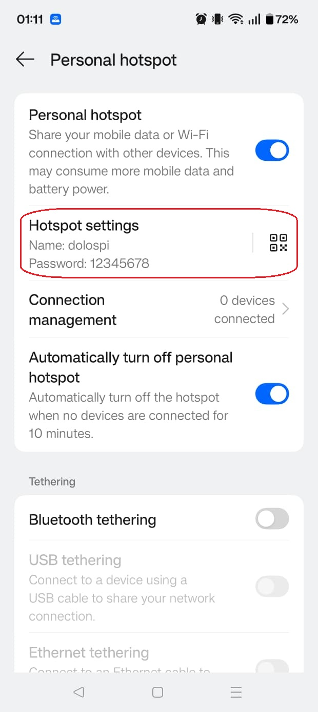

1. Activa ese punto de acceso y déjalo encendido.
2. Enciende la cámara con el interruptor.
3. Espera a que la luz deje de parpadear al arrancar y se quede **fija**. Eso quiere decir que ya está en **dolospi** y tiene internet.

Si la luz se queda apagada, el punto de acceso no está activo, el nombre no es exactamente `dolospi`, o la contraseña no es `12345678`.

### 3.3 Introducir el código

En el teléfono o en el ordenador, con tu propia conexión (no hace falta que sea la red dolospi):

1. Abre la página y entra en tu cuenta.
2. Pulsa **Añadir cámara**.
3. En **Código de vinculación** escribe el código de la tarjeta.
4. En **Nombre** pon el que quieras. Si no lo cambias, se queda **Mi cámara**.
5. Pulsa **Vincular**.

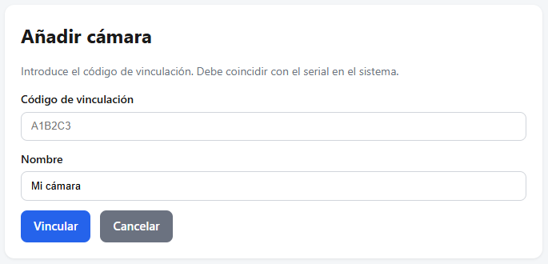

La página abre la cámara y dice que debería aparecer **En línea** en unos 30 segundos. Si la luz ya estaba fija, no tienes que hacer nada más en la cámara.

### 3.4 Lo que hace la cámara sola

En cuanto queda vinculada, y mientras sigue conectada a internet, la cámara **pide sola** todas las redes Wi‑Fi guardadas en tu cuenta y las guarda. No hay que volver a escribir la contraseña en la cámara, ni pulsar ningún botón en ella.

- Si esas redes ya estaban en la cuenta antes de vincular, bajan en ese momento.
- Si la cámara estaba **En línea** y añades o borras una red después, también se actualiza sola.
- Si añades una red con la cámara **apagada**, no se sincroniza hasta que vuelva a estar encendida y con internet (apartado 2.7).

La red **dolospi** se conserva. Así, si más adelante la cámara no ve ninguna red de tu lista, puedes volver a encender el punto de acceso del teléfono y tendrá otra vez internet para recibir cambios.

### 3.5 Pasarla a la red Wi-Fi que vas a usar

1. Comprueba en **Ajustes → Todas las cámaras** que el Wi‑Fi de casa está en la lista.
2. Con la cámara todavía **En línea** por **dolospi**, espera unos segundos después de añadir esa red, si no estaba ya.
3. Apaga el punto de acceso del teléfono.
4. La luz se apaga mientras cambia de red. Cuando se queda fija otra vez, ya está en una red de tu lista.
5. En la página, el estado vuelve a **En línea**.

A partir de aquí, en casa basta con encender el interruptor. Entra sola en esa red. La luz fija y el estado **En línea** lo confirman.

### 3.6 Si añadiste el Wi‑Fi con la cámara apagada

La página no avisa de forma especial: la red sale en la lista y parece configurada. La cámara, apagada, no la tiene.

Para que llegue:

1. Deja la red en la lista. No hace falta borrarla y crearla otra vez.
2. Enciende el punto de acceso **dolospi** / **12345678** o cualquier red que la cámara ya tenga descargada.
3. Enciende la cámara y espera la luz fija.
4. Espera a que pase a **En línea** en la página. En ese momento descarga sola la lista, incluida la red que añadiste mientras estaba apagada.
5. Apaga el punto de acceso. La luz debe volver a quedarse fija, ya en tu red.

Si la enciendes solo al lado del router, sin el punto de acceso y sin haber recibido nunca esa red, la luz sigue apagada y la página sigue en **Desconectada** la cámara todavía no conoce esa red, y sin internet no puede descargarla.